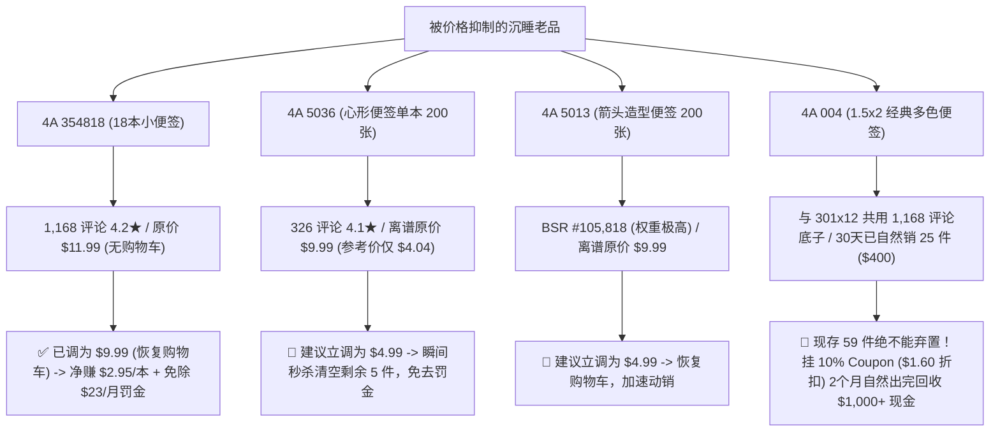

# 4A (USA) LIMITED - 沉睡金矿激活与三梯队去屎山执行方案

> **核心目标**：从日销 $500 稳步推升至 **$800+/天**（月销 $2.4万刀，日净利约 $200 刀/¥1,420 元）；停止每月 $774.60 库龄罚金；打破“实体杂货铺”思维，打造以核心爆款群为支撑的精简现代化店铺。

---

## 一、 Veo 3.1 - Lite vs Omni 1.1 Flash 深度评测对比

对于工厂实体产品（便签、纸品、文具）的电商主图商业视频，**Veo 3.1 - Lite 在画质物理规律与点数性价比上全面碾压 Omni 1.1 Flash**：

| 评估维度 | Veo 3.1 - Lite (当前主力) | Omni 1.1 Flash | 电商视频实战结论 |
| :--- | :--- | :--- | :--- |
| **点数成本 (720p 8s)** | **10 点**（更便宜） | **12 点**（多消耗 20%） | **Veo 3.1 完胜**：同样生成 3 个镜头省 6 点，能多做半个视频。 |
| **纸品物理规律与质感** | **超高**：真实模拟 80 GSM 纸张挺度，撕取便签（Shot 2）具有自然的剪切张力，绝无果冻感。 | **偏低/橡胶化**：自回归生成易将纸张渲染成软橡胶或布料，撕扯弯折极不自然。 | **Veo 3.1 完胜**：办公文具最忌讳“纸张像塑料/橡皮泥”。 |
| **人手微动作与书写笔迹** | **极高解剖稳定性**：手指关节自然，笔尖触碰纸张瞬间墨水延展，光影顺滑。 | **偶发幻觉**：易出现 6 指、笔身悬空漂浮、或笔还没落下去纸上就自己出字的 AI 破绽。 | **Veo 3.1 完胜**：真实度直接决定买家信任度与转化率。 |
| **印刷网格/横线稳定性** | **绝对平行稳定**：8 秒内横线（Rule lines）无波纹抖动与像素融化。 | **中等**：背景网格或边缘文字在镜头推拉时容易产生微小扭曲漂移。 | **Veo 3.1 完胜**：线条工整体现大厂品控。 |
| **静音模式 (Silent Mode)** | **支持专属静音**：完全不耗费 Token 去脑补音频，全部算力投入画面高频细节。 | 需同时处理多模态音视频，算力分流。 | **Veo 3.1 完胜**：亚马逊主图视频 70%+ 买家静音浏览，画面纯净最关键。 |

> **最终结论**：继续坚决采用 **Veo 3.1 - Lite（10 pts/镜头）** 作为标准生产管线，既省钱又具备工业级物理质感。

---

## 二、 那些跟 354818 一样“被价格剥夺购买权”的沉睡金矿

正如阿姨所言，上任新手运营根本不懂亚马逊的“购物车保护算法（Buy Box）”，盲目标出反常离谱价格，导致亚马逊判定价格缺乏竞争力，**强制隐藏了“加入购物车”按钮（丢失购物车，Buy Box 抑制）**。

买家在搜索结果中看不到价格，进详情页还要点击“查看所有购买选项（See All Buying Options）”才能购买，转化率直接暴跌 90%！

### 核心金矿拯救清单（立调生效，零成本激活）：

---

## 三、 彻底清理 854 个 Listing “屎山”的三梯队作战地图

阿姨看得很透彻：**实体店是“货架铺得越满越显得大”，但亚马逊是“单品打到前列通吃一切”**。854 个零散 SKU 不仅把工厂的广告费稀释成胡椒面，还让亚马逊每月狂扣几百美金的超期仓储费。

### 梯队 1：核心金矿群（倾斜资源，打造现金奶牛）
- **标的**：`354818`、`406x6 系列`、`5082-Y-L`、`BS 1801 礼盒`、`4A 004`、`301x12`。
- **动作**：
  1. 保证 Buy Box 100% 拥有（价格精准卡在推荐参考线）。
  2. 补齐 B2B 企业价格（2件97折/5件95折，收割学校和公司集采）。
  3. 配置 Veo 商业视频与高清主图/A+。
- **预期产出**：贡献全店 80% 以上的稳定日销（$650~$700/天）。

### 梯队 2：标准功能货（打折/优惠券加速回款，不再盲目补大货）
- **标的**：`6031x4`（1.2x2 索引标签，77 件）、`305x6`（3x5 横线，17 件）、`4012/4013 PP盒装`。
- **动作**：
  1. 挂 **20%~25% 绿色优惠券（Coupons）**，保留原标价锚点，前台形成强烈折扣吸引力。
  2. 配合低竞价（$0.25 CPC）捡漏广告承接流量，在 30~45 天内把库存变成现金。
- **预期产出**：每月回收 $800~$1,500 美元流动资金，彻底清除每月几十刀的超期滞纳费。

### 梯队 3：无价值死库存与重复垃圾 Listing（坚决淘汰，后台归档）
- **标的**：
  1. **已弃置大件**：`4A071`、`MEETING-41-W*4`、`Meeting 42x4`（已提交弃置单 `2610291A0B`，年省 $959.16）。
  2. **奇葩重叠规格**：`4A 301x24x2`（48本装超大包）、`303-Holder+Flag` 冗余笔筒、`30315` 15色冷门装、`5037x2` 树形2本装。
- **动作**：
  1. 仓内剩余尾货 5 折甚至 4 折甩卖或参与亚马逊清算。
  2. **后台大扫除**：对库存为 0 且无评价的幽灵 Listing 进行“关闭并删除商品与报价”（Delete products and listings），将 854 个屎山精简至约 50~60 个清晰有力的主力父子体变体组！

---

## 四、 父亲与工厂沟通策略：用不可辩驳的数据说话

1. **破局点**：今天周三的日销不仅跑赢了全月所有周三，而且这还是在绝大部分优化才刚刚提交、尚未完全被算法收录的前提下取得的。
2. **财务底牌**：
   - 只要日销稳定在 **$800 刀**，工厂每个月进账 **$24,000 美元（约合人民币 17 万元）**。
   - 除去亚马逊佣金、配送费、头程和原材料，每月沉淀纯利润超 **¥43,000 元现金**！
   - 每半个月亚马逊直接按美元电汇结算回款，**没有任何国内贸易的欠款与账期风险**。
   - 加上我们斩断的每年近万元人民币的仓储滞纳罚金，数字摆在桌面上，阿姨全力支持，叔叔自然会心悦诚服并放开全部运营权限！
