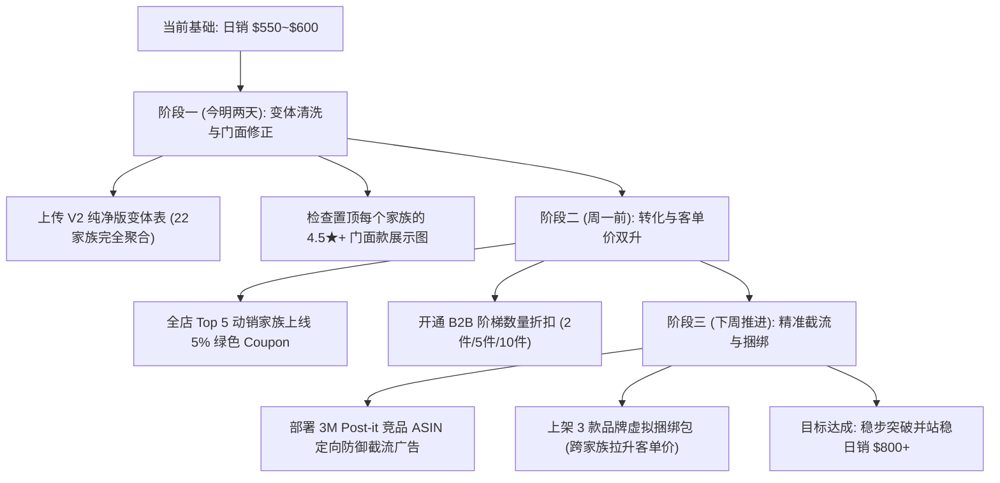

# 4A 店铺日销稳定冲刺并站稳 $800+ 增长规划与实操路线图

---

## 一、 目标量化与差距拆解（Gap Analysis）

* **当前实盘基准**：日销约 **`$550 ~ $600`**（日均约 22~25 笔订单，30~35 件商品，客单价约 $24~$27）。
* **冲刺目标**：**稳定在 `$800+` / 天**（月度总销突破 **`$24,000 ~ $25,000`**）。
* **缺口量化**：每天仅需弥补 **`+$200 ~ +$250`** 的增量。
* **达成数学模型**：
  $$\text{增量 \$220} = \text{新增 6~8 笔高客单企业单} \quad \text{或} \quad \text{新增 10~12 笔普通订单} \quad \text{或} \quad \text{整体客单价提升 \$6~8}$$

> [!NOTE]
> 这意味着我们**不需要**冒巨大风险去盲目烧广告或全面降价，而是通过**“3 个转化倍增器 + 2 个客单价杠杆 + 1 个防断货底线”**，就能稳稳把这每天缺失的 8~10 单或客单价拉上去。

---

## 二、 三大转化倍增器（稳稳贡献每天 +6~8 笔订单）

### 1. 挂上“绿色优惠券 (Green Coupon)”——搜索结果页最强吸睛符号
* **核心痛点**：在亚马逊搜索结果页（SERP），买家面对几十款便签纸比价极其严重，普通白底标题很难形成第一视觉吸附。
* **增益事实**：带有 **绿底白字 `Save 5%` 或 `Save $1.00`** 徽章的 Listing，点击率（CTR）通常暴涨 **25%~35%**，详情页转化率（CVR）提升 **15%~20%**。
* **实操落地**：
  * 为全店动销 Top 5 核心家族（满胶 303、PSS 卷装、5084 线格、301 迷你便签、30315）统一创建 **5% 或 $1.00 Clip Coupon**；
  * **成本极度可控**：优惠券每核销一次亚马逊仅收 $0.60 兑换费，只有真正成交才产生费用，比盲目提高广告出价性价比高 3 倍以上。

### 2. 变体聚合后的“门面子体 (Hero Child)”权重置顶
* **核心痛点**：21 大家族整合后，如果系统随机或者因历史原因把一个“低分款”、“缺货款”或“冷门颜色”作为搜索结果页的主展示图，买家点击意愿会大幅下降（如刚才前台误展示为 0 库存的 2 包款）。
* **实操落地**：
  * 变体合并生效后，地毯式检查每个家族的**前台默认展示款**；
  * 确保每一组变体展示的都是家族中**“评分最高（4.5★+）、主图质感最好（新渲染 2000x2000 白底高光图）、现货库存最充足”**的爆款子体。

### 3. 精准竞品 ASIN 截流（Product Attribute Targeting）
* **核心痛点**：去打 `sticky notes` 这种大词，每次点击 $1.5~$2.5 刀，容易被 3M Post-it 这种国际巨头消耗预算。
* **降维截流打法**：
  * 针对 3M Post-it 和 Amazon Basics 的高客单单品（例如售价 $22~$26 的 12~18 本装）；
  * 用我们极具性价比的爆款（如 30315 15本装 $14.99、PSS 卷装）直接打**商品投放广告（PAT）**，精准挂在它们的产品详情页下方（“Products related to this item”广告栏）；
  * 买家在 3M 页面嫌贵时，一眼看到我们的 15 本装便宜 $5~8 刀且颜色更丰富，直接顺手截流购买！

---

## 三、 两大客单价杠杆（把全店客单价从 $25 拉升至 $35+）

### 1. 深度激活 Amazon Business (B2B) 阶梯数量折扣
* **底层逻辑**：便签纸是典型的企业、学校、律所、医院高频大宗消耗品。从我们近两天的订单穿透看，**B2B 企业买家动辄单笔买 2 套、买 4 套卷装便签（单笔直接贡献 $55.96）**！
* **实操落地**：
  * 在现有的 95 折企业单价基础上，在后台（Manage Pricing -> Business Price）配置**数量阶梯折扣（Tiered Discounts）**：
    * 购买 2 ~ 4 件：额外优惠 **3%**
    * 购买 5 ~ 9 件：额外优惠 **5%**
    * 购买 10 件以上：额外优惠 **8%**
  * 企业采购看到数量折扣会直接放弃单件加购，倾向于整箱或批量下单。**只要每天多抓到 2 笔企业批量单，就轻松多出 $80~$120 刀！**

### 2. 品牌虚拟捆绑包 (Virtual Product Bundles)
* **底层逻辑**：零额外备货成本，通过跨品类组合把客单价翻倍。
* **实操落地**：
  * 利用亚马逊后台品牌工具搭建 3 组虚拟捆绑包：
    1. **【办公全能套】**：303 满胶便签（大号）+ 301 迷你索引标签，组合优惠 $1.50；
    2. **【学生彩色套】**：5084 线格便签 + 30315 彩虹便签；
    3. **【极速便签套】**：PSS 弹跳便签 + 补充装（Refill）。
  * 买家在详情页看到一键购买两者享受组合折扣，FBA 仓库自动从现有两款库存里分别拣货发出，直接把单单 $15 拉高到 $30+。

---

## 四、 一大防断货生命线（守住成果，杜绝冲上 800 又断崖下跌）

* **痛点警示**：中小卖家冲高回落的第一死因就是**“核心单品断货”**。一旦像 30315（仅剩 22 件）这类主力款断货，Listing 变灰，BSR 排名和自然搜索权重几天内就会腰斩。
* **防断货双轨机制**：
  1. **低库存红线预警**：建立库存周转监控，凡 FBA 可售库存低于 20 件的动销款，标记为红色预警；
  2. **FBM 自发货无缝兜底**：一旦 FBA 降至 5 件以下，立即开启自发货库存（使用已建好的 Cube delivery $8.99 运费模板），确保 Buy Box 永不断流、权重永不归零。

---

## 五、 实操执行排期表

