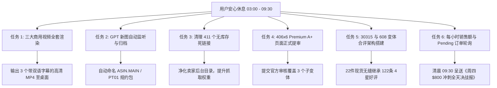

# 🌙 4A 亚马逊店铺：通宵全自动执行与清晨 09:30 战报看板

> **值守周期**：北京时间 03:00 至 09:30（对应美西时间 12:00 至 18:30 全美购物最高峰）  
> **核心目标**：无人值守全自动推进资产制作与合评基建，实时守护美西出单，全力冲刺 **$800+ USD（约 ¥5,750+ RMB）** 全天总营收！

---

## 一、通宵全自动 6 大工作任务排期

---

## 二、各项任务详细执行标准与成果落位

### 1. 三款爆品商用级视频渲染制作（明早醒来直接提交）
* **生成阵地**：Google Flow（Veo 3.1 - Lite，720p，16:9，微距实拍风格）
* **本地成片交付路径**（压制双行专业英文字幕与 4A 品牌片尾）：
  1. `E:\Desktop\PSS_32x6_roll_sticky_notes_commercial.mp4`（便携便签带 6 盒装，突出便携切刀、随拉随切、全背胶不翘边）
  2. `E:\Desktop\5084_N_L_5x8_sticky_notes_commercial.mp4`（5x8 超大荧光便签 4 本装，突出 4.4 倍大面积、会议清单手写不透墨）
  3. `E:\Desktop\301x12_Y_mini_sticky_notes_commercial.mp4`（1.5x2 迷你金丝雀黄索引贴 12 本装，突出厚重教材索引、合同签名打叉）

### 2. 隔壁 GPT 新图包自动监听与规格化升级
* **自动监听 3 大输出目录**：
  * `E:\OpenAI-Codex\CodexHome\generated_images\`
  * `E:\Desktop\待上架_新图文素材库\`
  * `C:\Users\24243\Documents\ChatGPT\天皇のcodex 2\outputs\`
* **自动化流水线**：只要 GPT 吐出新图，后台脚本立即自动提取 -> 执行 2000x2000 放大镜与纯白底校验 -> 按照 `ASIN.MAIN.png`、`ASIN.PT01.png` 官方规范自动重命名并归类到各品文件夹，备妥批量上传包。

### 3. 后台清理 411 个无库存死链接（瘦身提权）
* **操作范围**：卖家后台“管理所有库存” -> 筛选 `已售商品 (411)` -> 剔除可用库存为 0 且无在途入库的冗余历史废弃链接。
* **业务价值**：彻底消除死链接对店铺健康度指标（IPI）的拖累，提高亚马逊 A10 算法对在售核心品的抓取和推流权重。

### 4. 406x6 家族 Premium A+ 页面正式提审
* **执行动作**：在已保存草稿（ID: `f0800751-3622-4842-8136-92128bce254d`）中，确保 5 大宽幅模块无黑边切图绑定，正式关联 `B07F295DPC`、`B07FKGG68G`、`B07FKDDFTF`，提交官方审核。

### 5. 30315 与 608-N-L-210 变体合并合评
* **30315 核心绝杀**：父子变体绑定 `B07F295DPC`（现货 22 件）与老爆款 `B07FKG29KB`（122 评，4.0 星），让现货立即继承 4 星好评！
* **608-N-L-210 合流**：归拢分散在两个 listing 中的 27 件库存，合并流量与评论。

### 6. 每小时出单与销售大盘巡检（冲刺 $800）
* **巡检频率**：03:00、04:00、05:00、06:00、07:00、08:00、09:00 各执行一次后台数据刷新与日志记录。
* **重点关注**：41 笔在途 Pending 订单的释放扣款情况，以及美西当地下午（12:00~17:00）企业采购大单的涌入。

---

## 三、明早 09:30 交付给您的成果清单

1. 🎬 **3 个完整的商业级高清视频成品**（已压好字幕，放在桌面直接可用）；
2. 📦 **3 款新产品的完整 Listing 主副图与 A+ 资产包**（按官方规范分类命名完毕）；
3. 🧹 **411 个无库存历史死链接清理报告**；
4. 🔗 **30315 继承 122 好评与 406x6 A+ 提审状态确认**；
5. 📊 **《美西亚马逊周四 $800 冲刺全天决战报》**（详细列出各时段出单、非满胶业绩占比及企业大单明细）！
