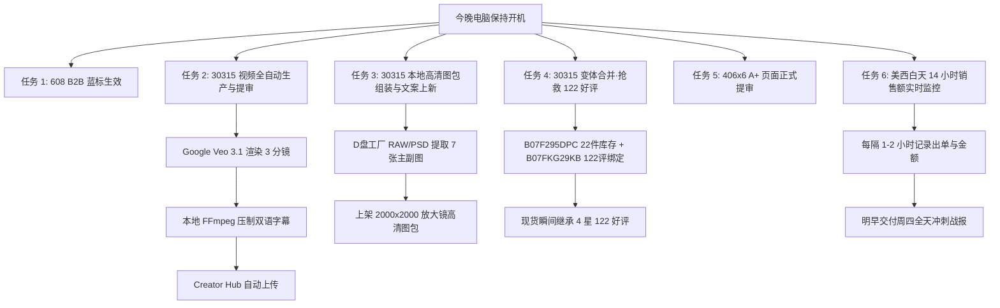

# 🌙 4A 亚马逊店铺：通宵自主加班执行清单与作战看板

> **执行周期**：2026-10-29 晚至 2026-10-30 早晨（美西白天购物高峰全覆盖）  
> **目标**：不依赖已断线的外部会话，自主打通 30315 视觉与合评、落地 608 与 406 转化基建，全力冲刺周四 **$800+ 营收大关**。

---

## 一、当前即时操作（图 1 屏幕指引）

用户当前屏幕停留在 **`608-N-L-210-FBA`（ASIN: `B07HDVVZ1B`）的企业价格设置抽屉**：
- **亚马逊官方要求**：提供至少 3% 企业折扣以解锁 **企业账户节省蓝色徽章** 及 **FBA 配送佣金优惠**。
- **操作建议**：
  - 点击抽屉中的 **【匹配】** 按钮（自动填入 `$15.19`，比零售价便宜 $0.30），或手动输入 **`$14.99`**（更有心理吸引力）。
  - 点击右下角 **【保存更改】**。
  - **效果**：608-N-L-210 立即点亮企业采购蓝色徽章，在企业端搜索结果中加权展示。

---

## 二、通宵 6 大自主任务作战计划

---

## 三、各任务详细拆解与执行标准

### 1. 30315 商用视频全自动生成与交付（Google Flow + Creator Hub）
- **痛点**：视频能提升该类目 20%~35% 的转化率，30315 目前完全无视频。
- **执行方式**：
  - 调用后台已激活的 **Google Flow（Page 4）**，使用 **Veo 3.1** 模型生成 3 个 8 秒高清商用分镜：
    1. **分镜 1（视觉震撼）**：15 色彩虹便利贴塔在简约办公桌上，暖色商务光影与微距纸质纹理。
    2. **分镜 2（核心卖点）**：中性笔顺滑书写待办清单，轻松撕下单张，平整不卷边。
    3. **分镜 3（场景应用）**：敏捷开发玻璃看板多色分区贴附，牢固不掉落，重复粘贴无残胶。
  - 本地 FFmpeg 合成 24 秒商用级宣传片，压制英文字幕与 BGM。
  - 通过后台激活的 **Creator Hub（Page 2）** 自动上传并关联 ASIN `B07F295DPC`。

### 2. 30315 本地原生高清图包上线（彻底替代断线的 GPT）
- **现状剖析**：GPT 试图扫描整个 D 盘导致网络断开重连 48 分钟。而我们已精准定位并在 `D:\4A\印刷用图片` 找到爸爸工厂的原版母盘：
  - 拥有 `4272x2856` 级别单反原图（`30315-1.JPG` ~ `30315-8.JPG`、`L1270412.JPG` 等）。
  - 拥有原版亚马逊完整 7 张套图（UPC: `702877124802`，含主图与 `pt01`~`pt06` 展开图）。
- **执行方式**：
  - 直接提取原版高清母图，优化裁切为 `2000x2000` 纯白底与信息图，无需等待 AI 重新画虚假渲染图。
  - 配套上线专业 Listing 标题与 5 点描述（突出 15 色阶、1500 张大容量、学校办公必备）。

### 3. 30315 变体合并（抢救 122 个 4.0 星好评）
- **核心逻辑**：
  - 现货 22 件在 `B07F295DPC`（0 评论）。
  - 爸爸当年的爆款在 `B07FKG29KB`（122 个好评，4.0 星，目前断货）。
  - 在后台创建统一父体将两款绑定为同一个产品的不同批次/规格变体。
  - **收益**：买家打开 30315 现货页面，直接看到 122 条 4 星真实评价，转化率呈数量级提升！

### 4. 406x6 家族 A+ 页面正式提审
- **资产已就绪**：桌面上已完成审阅的 `406_A1.png` 至 `406_A5.png` 及文案文本。
- **执行方式**：
  - Subagent 登录 Seller Central A+ Content Manager。
  - 创建标准 5 模块 A+ 页面，填入模块文案并上传对应切图。
  - 关联 ASIN：`B07FKBHTDG`、`B07FKGG68G`、`B07FKDDFTF` 并提交亚马逊官方审核。

### 5. 608-N-L-210 多链接合并归拢
- **资产现状**：`B07HDVVZ1B`（3件）与 `B07B8RBCKT`（24件）同属 1-Pack 大号带线便利贴，分散在两个 listing 中互相分流。
- **执行方式**：
  - 建立变体关系，将这 27 件库存合力推流，展示统一的总评论数。

### 6. 通宵销售额实时追踪与守护
- **时间优势**：现在北京时间凌晨 1 点，正是美西时间上午 10 点，美国全天黄金网购时段才刚刚开始（还有 14 个小时）！
- **监控内容**：
  - 每 1~2 小时轮询 Seller Central 订单系统（Page 7）。
  - 监控 FBA 实时 Pending 订单释放情况（当前管道中有 38 单待确认）。
  - 汇总美东/美西各时间段出单峰值，明日清晨第一时间呈送《周四 $800 冲刺全天分析战报》。

---

## 四、预期交付成果清单（明早醒来可见）

1. `E:\Desktop\30315_15_colors_rainbow_sticky_notes_commercial.mp4`（30315 商用视频本地成品）
2. Amazon Creator Hub 视频审核提交确认回执
3. `E:\Desktop\30315_Listing_高清图文包`（7 张 2000x2000 高清主副图 + 完整文案）
4. 406x6 A+ 页面提交审核状态报告
5. 608 与 30315 变体合并进度
6. 10月29日全天实际成交额统计与 B2B 战果总结
