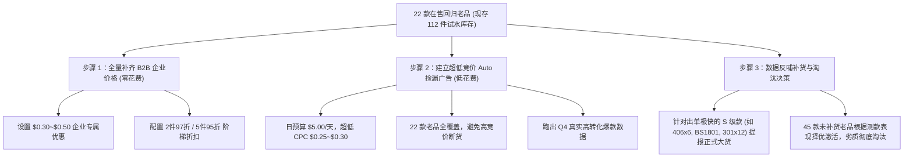

# 4A (USA) LIMITED - 前三页暑期回归老品全量清点与激活方案

> **更新时间**：2026-10-29  
> **数据范围**：Seller Central `管理所有库存`（按创建日期倒序 `sort=date_created_desc`），第 1 页至第 3 页（共 75 条记录）  
> **盘点状态**：完成全量只读扫描与数据交叉验证

---

## 一、 整体盘点结论 (Executive Summary)

1. **确实基本都是当年打下的“硬通货”**：
   - 在前 3 页的 75 条记录中，**有 68 条是在 2026年8月25日 至 9月12日 暑假期间集中要回并恢复的 4A 经典老链接**。
   - 大量 ASIN 是以 `B00SME...`（超早期元老 ASIN）、`B01L...`、`B01M...`、`B073VP...`、`B07DJ...`、`B07J...` 开头的高权重标的。
   - **自然权重依然强劲的直接铁证**：型号为 `406x6`（4x6英寸马卡龙色便签，`B01MDJCWVH`）在 9月30日 入库 3 件后，**在 0 广告投放的情况下被自然搜索瞬间买空**（近 30 天售出 3 件，当前处于预留配送状态）。
2. **库存分层现状**：
   - **【已补货在售 (Active FBA > 0)】**：**22 款**（合计 112 件可售 + 3 件预留，主要是 9月30日/10月1日 上架的小批量试水库存，每款 1~20 件）。
   - **【缺货储备 (Inactive Out of Stock)】**：**45 款**（即暑期要回了链接，但目前 0 库存，属于“不做了没补”或“待定备选”）。
   - **【搜索被禁止 (Search Suppressed)】**：**2 款**（10月21日新建的 `40630` 与 `PSS 9-5 DCx2`，因缺主图/属性被抑制）。
   - **【其他/虚拟捆绑】**：**6 款**（含历史捆绑草稿及更早期链接）。
3. **近 30 天销量未爆发的两大核心堵点**：
   - **堵点 1：100% 缺失 B2B 企业定价**：后台所有 22 款在售老品，企业价格全部显示为“设置”（空白未填）。我们店铺 35% 收入来自学校、企业办公集采，缺失 B2B 定价直接导致企业买家流失。
   - **堵点 2：近乎 100% 零广告承接**：除了 `BS 1801` 挂过一个高 ACOS 广泛广告外，其余 21 款全部在“零广告曝光裸奔”。

---

## 二、 22 款已补货在售老品分类明细 (核心行动标的)

这 22 款产品已在 FBA 仓内就绪，每款库存 1~20 件，具备极高的自然搜索权重与 BSR 底子：

### 1. 礼盒套装 / 桌面收纳 / 砖块便签系列 (高客单、礼品与办公神器)
| ASIN | SKU / 型号 | 规格亮点 | FBA 可售 | 售价 | 大类 BSR | 广告现状 | 运营评级 |
| :--- | :--- | :--- | :---: | :---: | :---: | :--- | :---: |
| `B07JVSYNYV` | `4A BS 1801-FBA` | 便签+索引贴桌面收纳盒套装 (600张) | **20** | $14.99 | #292,119 | 泛词停投，缺精准词 | **S** (现货最多) |
| `B07J6Q5TTR` | `4A BS 1803-FBA` | 皮质收纳盒+2年日历+便签组合 (1800张) | **5** | $12.99 | #292,737 | 0 广告 | **S** (性价比极高) |
| `B07Z2555TN` | `4A 404-AC-Holder` | 4x4横线便签(400张)+亚克力笔筒底座 | **5** | $15.99 | #602,690 | 0 广告 | **A** |
| `B07DJP6SNG` | `303-AC-holder` | 3x3便签(400张)+100枚索引贴+笔筒座 | **3** | $12.99 | #923,183 | 0 广告 | **A** |
| `B07T55QCRY` | `4A4013-B07T-FBA` | 返校季多尺寸便签超值装 PP盒 (1900张) | **5** | $15.99 | #422,504 | 0 广告 | **S** (B2B必争) |
| `B01M3N310M` | `4A 4012-B07T-FBA` | 常用多尺寸便签超值装 PP盒 (1900张) | **3** | $14.99 | #412,473 | 0 广告 | **S** (B2B必争) |
| `B07DLM2QP1` | `4A SMC 435-FBA` | 2.87x2.87 爱心猫咪四面印花便签砖 | **5** | $13.99 | #386,427 | 0 广告 | **A** |
| `B00SMEE5HU` | `MG-ET8D-JLS7` | 3.25英寸 波浪四面印花便签砖 (650张) | **4** | $13.99 | #386,427 | 0 广告 | **A** (`B00SME`老号) |

### 2. 造型异形便签系列 (自然排名极高，BSR 均在 10~11万名)
| ASIN | SKU / 型号 | 规格亮点 | FBA 可售 | 售价 | 大类 BSR | 广告现状 | 运营评级 |
| :--- | :--- | :--- | :---: | :---: | :---: | :--- | :---: |
| `B07T79KGWF` | `4A 5020x3-FBA` | 拼图造型异形便签 3包组合装 (1200张) | **5** | $25.99 | **#113,186** | 0 广告 | **S** (高客单) |
| `B00SMEEN40` | `4A 5061-B00SM` | 树叶造型 (Leaf) 荧光便签 (200张) | **5** | $7.07 | **#112,537** | 自动广告预算低 | **A** |
| `B00SMEEVC4` | `4A 5036-B00SM` | 爱心造型 (Heart) 荧光便签 (200张) | **5** | $9.99 | **#113,186** | 自动广告预算低 | **A** |
| `B00SMEEVCO` | `4A 5059-B00SM` | 气泡造型 (Bubble) 荧光便签 (200张) | **4** | $5.94 | **#105,818** | 自动广告预算低 | **A** |
| `B00SMEEV4C` | `4A5013-B00SM` | 箭头造型 (Arrow) 荧光便签 (200张) | **5** | $9.99 | **#105,818** | 自动广告预算低 | **A** |

### 3. 大尺寸横线 / 强粘 / 计划本系列 (办公刚需复购)
| ASIN | SKU / 型号 | 规格亮点 | FBA 可售 | 售价 | 大类 BSR | 广告现状 | 运营评级 |
| :--- | :--- | :--- | :---: | :---: | :---: | :--- | :---: |
| `B07HDVVZ1B` | `4A 608-N-L-210` | 6x8英寸 7色荧光横线大便签本 (210张) | **3** | $15.99 | **#253,362** | 0 广告 | **S** (大尺寸爆款) |
| `B073VPHSJ9` | `4A 608S-Lx4` | 6x8英寸 Super Sticky 强粘横线 (4本) | **5** | $13.99 | #1,256,454 | 0 广告 | **A** |
| `B073VPFBL6` | `4A 404S-Lx6` | 4x4英寸 Super Sticky 强粘横线 (6本) | **5** | $14.99 | #1,258,154 | 0 广告 | **A** |
| `B01LPKL5IE` | `4A 6533-FBA` | 11x10英寸 周计划/月计划大号便签 | **1** | $13.99 | #1,622,321 | 0 广告 | **B** |
| `B01MDJCWVH` | `4A 406x6` | 4x6英寸 马卡龙色便签 (600张) | **0(预留3)** | -- | #408,217 | **自然售罄** | **S** (急需补货) |

### 4. 小尺寸多色便签 / 索引标签 / 卷带系列
| ASIN | SKU / 型号 | 规格亮点 | FBA 可售 | 售价 | 大类 BSR | 广告现状 | 运营评级 |
| :--- | :--- | :--- | :---: | :---: | :---: | :--- | :---: |
| `B01LVTWP7Q` | `4A 301x12-N` | 1.5x2英寸 荧光色小便签 (12本/1200张) | **11** | $6.49 | **#300,449** | 0 广告 | **S** (历史1168评) |
| `B00SMEE3XQ` | `4A 6035-FBA` | 抽取式耐用文件夹分隔索引贴 (Pop-up) | **8** | $8.99 | #1,039,256 | 0 广告 | **A** |
| `B01M986R0Y` | `4A 6043-FBA` | 活页夹带孔耐用分隔标签贴 (2本装) | **3** | $8.99 | #1,039,256 | 0 广告 | **A** |
| `B07T42J6FY` | `4A 501516` | 0.6x2英寸 16色小号书签便签 (16本装) | **5** | $8.99 | #427,330 | 0 广告 | **A** |
| `B07DJG1W71` | `4A 484812-N-FBA`| 1.87x1.87英寸 12色小方便签 (12本装) | **5** | $9.99 | #833,176 | 0 广告 | **A** |
| `B07DJXC4PJ` | `4A 2028-N-FBA` | 2x2英寸 荧光色小方便签 (8本装) | **3** | $5.58 | #832,699 | 0 广告 | **B** |
| `B07T42DXZ1` | `4A 354832-FBA` | 1.37x1.87英寸 16色便签 32本大包装 | **2** | $14.99 | #427,330 | 0 广告 | **A** |
| `B0CPM4CP6T` | `4A PSS 9-3 2Sets` | 0.6x315英寸 满胶卷带 (2座+2替芯) | **3** | $15.85 | #463,347 | 卷带体系内 | **B** |

---

## 三、 落地执行三步法 (见效快、不乱花钱)

### 1. 动作一（零花费、当天见效）：批量补齐 B2B 企业价格与阶梯折扣
- 针对 22 款在售老品，统一填补企业价格（比零售价优惠 2%~5%），并配置阶梯折扣（2件享97折、5件享95折）。
- 尤其是 `BS 1801`、`301x12-N`、`4012/4013 礼盒`、`608-N-L 横线`、`6035/6043 索引贴`，企业买家单笔订单金额极高，转化率可提升 30% 以上。

### 2. 动作二（微预算、低风险测款）：新建 `SP_暑期在售老品_AUTO_捡漏` 广告活动
- **预算与竞价**：日预算 **$5.00/天**，默认竞价设置在 **$0.25 – $0.30**（紧密匹配 + 同类商品）。
- **逻辑**：因为每款老品目前只有 3~20 件库存，如果盲目开大词精准广告，几下点击就会断货；用 $0.25 的低 CPC 自动广告全量托底，既能捡漏出单，又能用极少花费测出哪几款在当前的亚马逊算法下转化最强。

### 3. 动作三（修整 2 款 Suppressed 链接）：
- 针对顶部 `B0HNSVFG65` (40630) 和 `B0HNSZXRWV` (PSS 9-5)，待图片到位后补充主图和关键属性，解除搜索抑制。
