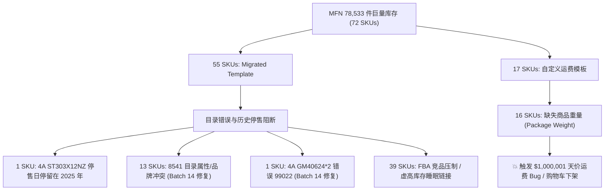
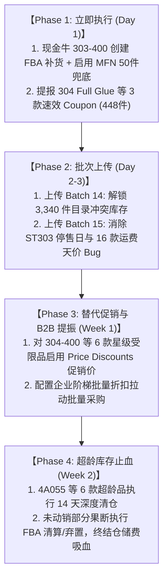

# 4A 便签店高库存变现与现金流盘活方案 (Cashflow Liquidation Plan)

> **生成时间**：2026-11-01 21:45 CST  
> **架构标准**：严格遵循 `00_Argon主脑与3.8子代理执行铁律_SOP.md`  
> **权威数据源**：官方 FBA 库存快照 (`284701020757.txt`)、全商品报告 (`11-01-2026.txt`)、10月全量订单报告 (`175793876516020757.txt`)、Coupon 全量扫描报告 (`coupon-fullscan-parsed.json`)、官方定价总表 (`亚马逊供应商和开店总表-2026(3).xlsx`)  

---

## 一、执行摘要：全局盘活与生命线告急 (Executive Summary)

### 1. 全店 10 月运营大盘与资金沉淀
- **10 月全店总销售额**：**$16,169.17**（有效订单 740 笔，有效销量 **901** 件）。
- **高库存 FBA 商品（在库可用 >= 50件）**：共 **24 个 SKU**，在库可用库存 **4,482** 件，10 月贡献销售额 **$11,347.88**（占全店 **70.2%**），但存在大额超龄库存与未开券滞销。
- **高库存 MFN 商品（声明库存 >= 300件）**：共 **72 个 SKU**，声明总库存 **78,533** 件，10 月仅 6 个 SKU 产生微量销售（合计仅 $145.15），其余 **66 个 Active 链接完全 0 销量**，主因受运费模板万倍暴涨（$1,000,001 异常）、2025 停售日过期及目录冲突阻断！

### 2. 现金牛一号生命线告急：`4A 303-Full Adhesive-400`（ASIN: `B07QXJYTZ7`）
> [!CAUTION] **全店最严重资金危机：现金牛即将在 9.9 天内断货，自发货备份处于 Inactive/0 库存状态！**
- **历史地位**：10 月单月销售 **179 件**，成交金额 **$3,988.93**，以单链接贡献全店 **21.3%** 的总营收，是全店当之无愧的 **第一支柱（Cash Cow #1）**。
- **库存断崖**：截至 10/30 快照，FBA 可用在库仅剩 **57 件**（中转 10 件，合计 67 件），**在途补货（Inbound）为 0**！
- **断货倒计时**：日均消耗速度约为 **5.77 件/天**，现有库存仅能支撑 **9.9 天**！预计 11 月 10 日前将彻底断货，届时 BSR 排名暴跌，全店单日营收将骤降 20% 以上。
- **自发货备份失效**：同体自发货 SKU `4A GM303-Full Adhesive-400` 声明数量为 **0**，状态为 **Inactive**，无法承接 FBA 断货流量。
- **抢救动作（P0 级）**：
  1. **立即下达 FBA 紧急空运/快船补货**（建议至少补货 500～1,000 件）。
  2. **立即启用 MFN 兜底库存**：在卖家后台为 `4A GM303-Full Adhesive-400` 声明 50～100 件国内/海外仓可用库存，保留 Migrated Template 包邮模板，防止 FBA 归零时前台下架。
  3. **维持现有价格 $22.99**：在自然高转化和断货危机下，**严禁降价或报名任何 Coupon**，守住利润与售罄节奏。

---

## 二、FBA 高库存资产矩阵与盘活方案（24 个 SKU 深度拆解）

FBA 在库 >= 50 件商品根据其**销售速度、折扣准入资格、库龄滞销风险**划分为四大战术阵营：

| SKU | ASIN | 可用库存 | 10月销量 | 10月销售额 | 库龄>365天 | 当前价格 | Coupon状态 | 准入/阻断原因 | 战术阵营与推荐动作 |
| :--- | :--- | :---: | :---: | :---: | :---: | :---: | :---: | :--- | :--- |
| `AAAA 4A 40609` | `B07FKBHTDG` | **612** | 26 | $285.74 | 0 | $10.99 | Active 5% | ✅ 允许创建优惠券 (Selectable) | **Active Coupon Liquidation** |
| `4A 304-Full Adhesive-400` | `B07QXJWDPL` | **533** | 10 | $211.24 | 0 | $21.99 | None | 您的商品目前不符合此优惠券的要求，因为该 ASIN 的星级评分未达到最 | **Blocked by Star Rating (<3.0)** |
| `4A 305-Full Adhesive` | `B0FBG138ND` | **428** | 123 | $1299.67 | 0 | $10.99 | None | 您的商品目前不符合此优惠券的要求，因为该 ASIN 的星级评分未达到最 | **Blocked by Star Rating (<3.0)** |
| `AAAA 4A 304-Full Glue` | `B07FK975YB` | **372** | 63 | $945.86 | 0 | $12.99 | None | 您的商品目前不符合此优惠券的要求，因为该 ASIN 的星级评分未达到最 | **Blocked by Star Rating (<3.0)** |
| `4A 302-Full Adhesive-400` | `B0F2TKL2P5` | **340** | 76 | $1335.27 | 0 | $17.99 | None | 您的商品目前不符合此优惠券的要求，因为该 ASIN 的星级评分未达到最 | **Blocked by Star Rating (<3.0)** |
| `4A 304 Full Glue` | `B00SMEFFRE` | **333** | 68 | $673.91 | 0 | $9.99 | None | ✅ 允许创建优惠券 (Selectable) | **Selectable Quick-Win (Missing Coupon)** |
| `4A 5082-Y-Lx2` | `B0F9L5G6XQ` | **292** | 68 | $1134.10 | 0 | $19.99 | Active 5% | ✅ 允许创建优惠券 (Selectable) | **Active Coupon Liquidation** |
| `4A 305-Full Adhesive-300` | `B07QXJZKHC` | **174** | 11 | $227.61 | 0 | $21.99 | None | 您的商品目前不符合此优惠券的要求，因为该 ASIN 的星级评分未达到最 | **Blocked by Star Rating (<3.0)** |
| `4A PSS 9-1 NYNRx2` | `B07QWKWWP2` | **162** | 2 | $45.98 | 0 | $22.99 | Active 15% | ✅ 允许创建优惠券 (Selectable) | **Active Coupon Liquidation** |
| `4A055` | `B00SMEENOU` | **140** | 0 | $0.00 | 138 | $7.51 | Active 15% | ✅ 允许创建优惠券 (Selectable) | **Active Coupon Liquidation** |
| `4A PSS 9-1 Grid-NYNGx2` | `B07R2KSW34` | **130** | 1 | $22.99 | 0 | $22.99 | Active 15% | ✅ 允许创建优惠券 (Selectable) | **Active Coupon Liquidation** |
| `AAAA 4A 5084-N-L` | `B07FKJM2LX` | **129** | 3 | $59.96 | 0 | $19.99 | Active 5% | ✅ 允许创建优惠券 (Selectable) | **Active Coupon Liquidation** |
| `4A 5084-N-L` | `B07F2B49BL` | **129** | 7 | $92.63 | 0 | $15.99 | Active 5% | ✅ 允许创建优惠券 (Selectable) | **Active Coupon Liquidation** |
| `AAAA 4A PSS 9-1 NGGrid` | `B07FK7PBHJ` | **98** | 0 | $0.00 | 0 | $19.99 | None | 您的商品目前不符合此优惠券的要求，因为该商品尚未产生任何销量。 | **Low Velocity / Ineligible** |
| `4A 6031x4` | `B07RP9K6KV` | **77** | 0 | $0.00 | 77 | $11.99 | Active 15% | ✅ 允许创建优惠券 (Selectable) | **Active Coupon Liquidation** |
| `4A PSS 9-1 Refill` | `B07QVKPZXX` | **67** | 9 | $170.91 | 0 | $18.99 | Active 5% | ✅ 允许创建优惠券 (Selectable) | **Active Coupon Liquidation** |
| `4A 5082-Y-L-GM` | `B07F2BHFJH` | **65** | 17 | $208.35 | 0 | $11.99 | None | ✅ 允许创建优惠券 (Selectable) | **Selectable Quick-Win (Missing Coupon)** |
| `AAAA 4A PSS 9-1 NRGrid` | `B07FKF5V92` | **63** | 2 | $39.98 | 0 | $0.00 | Active 15% | ✅ 允许创建优惠券 (Selectable) | **Active Coupon Liquidation** |
| `AAAA 4A 305-Full Glue` | `B07FK9BYHW` | **60** | 2 | $29.98 | 56 | $0.00 | None | 您的商品目前不符合此优惠券的要求，因为该 ASIN 的星级评分未达到最 | **Blocked by Star Rating (<3.0)** |
| `4A073` | `B00SMEEVKQ` | **60** | 0 | $0.00 | 58 | $10.99 | None | 您的商品价格过低，无法使用此优惠券。 为确保优惠券对买家有价值，参与优 | **Aged Zombie Stock (>365 Days)** |
| `4A 004` | `B01LVXOCU2` | **59** | 0 | $0.00 | 59 | $9.49 | None | 您的商品目前不符合此优惠券的要求，因为该商品尚未产生任何销量。 | **Aged Zombie Stock (>365 Days)** |
| `4A 303-Full Adhesive-400` | `B07QXJYTZ7` | **57** | 179 | $3988.93 | 0 | $22.99 | None | 您的商品目前不符合此优惠券的要求，因为该 ASIN 的星级评分未达到最 | **Cash Cow #1 (Stockout Risk)** |
| `4A 5088-Rainbow` | `B0F2YHTD8T` | **52** | 0 | $0.00 | 49 | $12.99 | Active 15% | ✅ 允许创建优惠券 (Selectable) | **Active Coupon Liquidation** |
| `4A 5020x3` | `B07RN7WQ81` | **50** | 23 | $574.77 | 0 | $25.99 | None | ✅ 允许创建优惠券 (Selectable) | **Selectable Quick-Win (Missing Coupon)** |

### 1. 战术阵营 A：可立即增补 Coupon 的“速效变现组”（3 个 SKU / 448 件）
> [!TIP] **快速提振现金流的低阻力抓手**
- **`4A 304 Full Glue` (`B00SMEFFRE`)**：
  - **现状**：可用库存 **333 件**，10 月自然销售 **68 件**（销售额 $679.32），售价 $9.99。目前无任何 Coupon。
  - **官方后台验证**：经 Coupon 全量扫描确认，此 ASIN **完全符合优惠券要求（Selectable: True，无任何报错）**。
  - **盘活方案**：立即提报 **10% 或 15% Coupon**，预计可将月销量从 68 件推升至 120+ 件，3 个月内完全回收资金（预计产生约 $3,000+ 现金流回笼），且该商品无 180 天以上超龄库存。
- **`4A 5082-Y-L-GM` (`B07F2BHFJH`)**：
  - **现状**：可用库存 **65 件**，10 月销售 **17 件**，售价 $11.99，无 Coupon。
  - **官方验证**：Selectable: True。同体兄弟已在 Batch 15 纠正黄色属性与尺寸。
  - **盘活方案**：配置 5%～10% Coupon，快速清仓剩余 65 件，消除 24 件 271-365 天临界库龄。
- **`4A 5020x3` (`B07RN7WQ81`)**：
  - **现状**：可用库存 **50 件**，10 月销售 **23 件**（$597.77），售价 $25.99。
  - **官方验证**：Selectable: True。高客单价优质变现资产。
  - **盘活方案**：配置 5% Coupon，预计 2 个月内自然售罄，回笼资金约 $1,200。

### 2. 战术阵营 B：受评分阻断的“高库存攻坚组”（6 个 SKU / 1,847 件）
> [!IMPORTANT] **阻断根因：历史星级评分 < 3.0，被亚马逊 Coupon 规则死锁**
以下 6 个核心 SKU 库存极大，但由于历史 review 评分低于平台门槛，无法通过优惠券引流：
1. **`4A 304-Full Adhesive-400` (`B07QXJWDPL`)**：可用 **533 件**（10月仅卖 10 件，售价 $21.99，评分 2.8）。
2. **`4A 305-Full Adhesive` (`B0FBG138ND`)**：可用 **428 件**（10月销量 128 件，售价 $10.99，评分 2.5）。
3. **`AAAA 4A 304-Full Glue` (`B07FK975YB`)**：可用 **372 件**（10月销量 63 件，售价 $12.99，评分 2.2）。
4. **`4A 302-Full Adhesive-400` (`B0F2TKL2P5`)**：可用 **340 件**（10月销量 76 件，售价 $17.99，评分 2.6）。
5. **`4A 305-Full Adhesive-300` (`B07QXJZKHC`)**：可用 **174 件**（10月销量 11 件，售价 $21.99，评分 2.6）。
6. **`AAAA 4A 305-Full Glue` (`B07FK9BYHW`)**：可用 **60 件**（评分 2.6，含 56 件超龄库存）。
- **破局方案（替代性降价/促销工具）**：
  - **通道一：启用后台『管理促销 -> 价格折扣 (Price Discounts / Sale Price)』**。绕过 Coupon 星级限制，对 `304-400` 设置限时促销价（例如 $18.99），直接在前台打标降价红标。
  - **通道二：B2B 阶梯批量价格（Quantity Discounts）**。为学校/企业采购设置 2件 5%、5件 10% 采购折扣，拉动办公室批量消耗。
  - **通道三：Prime 专享折扣（Prime Exclusive Discounts）**。若符合 PED 最低门槛，在大促节点（黑五/网一）报入专享折扣。

### 3. 战术阵营 C：超龄滞销与长期仓储费吸血组（6 个 SKU / 436 件库龄>365天）
> [!WARNING] **资金失血点：每月持续产生高额超龄库存附加费（Aged Inventory Surcharge）**
- **`4A055` (`B00SMEENOU`)**：可用 140 件，**138 件库龄 > 456 天**！10 月销售 0 件。虽挂 15% 券但完全无动销。
- **`4A 6031x4` (`B07RP9K6KV`)**：可用 77 件，**76 件库龄 > 456 天**！10 月销售 0 件。挂 15% 券无动销。
- **`4A073` (`B00SMEEVKQ`)**：可用 60 件，**58 件库龄 > 456 天**！10 月销售 0 件。因价格低无法用券。
- **`4A 004` (`B01LVXOCU2`)**：可用 59 件，**59 件库龄 > 456 天**！10 月销售 0 件。新/无销量无法用券。
- **`AAAA 4A 305-Full Glue` (`B07FK9BYHW`)**：可用 60 件，**56 件库龄 366-455 天**！
- **`4A 5088-Rainbow` (`B0F2YHTD8T`)**：可用 52 件，**49 件库龄 > 456 天**！
- **止血动作**：
  - 设定 14 天观察期：对这 6 款商品执行最后深度降价清仓。
  - 若 14 天内仍无法实现有效动销，果断在卖家后台创建 **批量弃置（Disposal）或清算（FBA Liquidations）订单**，彻底斩断每月数千美元的仓储费吸血黑洞！

---

## 三、MFN 高库存盘活与运费/停售解除方案（72 个 SKU / 78,533 件）

### 1. MFN 整体瘫痪根因诊断
全店 72 个声明库存 >= 300 件的 MFN 链接，累计囤积了 **78,533 件** 巨量库存，但 10 月动销率仅为 **8.3%**（仅 6 个 SKU 出单，且多为个位数）。通过交叉比对分类报告与运费模板，查明三大致命阻断因子：

### 2. 运费暴涨 $1,000,001 异常的 16 个重量缺失 SKU 盘查
> [!CAUTION] **运费模板致命缺陷**：下列 16 个高库存 SKU 被分配至按重量收费模板（如 `4A Parcel 7.99 plus 2.99 per lb`、`Heavy delivery`、`Big size delivery`、`Cube delivery`、`Biger size delivery-25`），但其亚马逊商品目录中**卖家包装重量（Package Weight）字段完全留空**！导致系统计算产生畸变，买家端结账页面显示运费高达 $1,000,001 或显示『无法配送到该地址』：

| MFN SKU | ASIN | 声明库存 | 售价 | 运费模板 | 缺失属性与阻断影响 | 解除方案 (Batch 14/15) |
| :--- | :--- | :---: | :---: | :--- | :--- | :--- |
| `4A GM5020x3` | `B07RN7WQ81` | **1,337** | $25.99 | `Cube delivery` | 缺失包装重量，按重计算触发系统运费保护性死锁 | 建议切回 Migrated 模板或补录包装重量 |
| `4A GMSCPSS 7` | `B0821LD25K` | **1,155** | $11.99 | `Cube delivery` | 缺失包装重量，按重计算触发系统运费保护性死锁 | 建议切回 Migrated 模板或补录包装重量 |
| `4A GM30315` | `B07FKG29KB` | **1,054** | $15.99 | `Cube delivery` | 缺失包装重量，按重计算触发系统运费保护性死锁 | 建议切回 Migrated 模板或补录包装重量 |
| `4A GMBP 1111-Px4` | `B07QZR9Z3P` | **1,010** | $29.99 | `4A Parcel 7.99 plus 2.99 per lb` | 缺失包装重量，按重计算触发系统运费保护性死锁 | 建议切回 Migrated 模板或补录包装重量 |
| `4A GMSMC 434` | `B07FKHNTRK` | **979** | $12.99 | `Cube delivery` | 缺失包装重量，按重计算触发系统运费保护性死锁 | 建议切回 Migrated 模板或补录包装重量 |
| `4A 019` | `B01LVZ0GV3` | **858** | $5.99 | `Big size delivery` | 缺失包装重量，按重计算触发系统运费保护性死锁 | 建议切回 Migrated 模板或补录包装重量 |
| `4A ST303X12NZ` | `B07FKL115P` | **858** | $10.99 | `Big size delivery` | 缺失包装重量，按重计算触发系统运费保护性死锁 | ✅ Batch 15延展停售日+补填1.15lb重量 |
| `4A GMBP 1111-Nx4` | `B07QWKYQV7` | **839** | $27.39 | `4A Parcel 7.99 plus 2.99 per lb` | 缺失包装重量，按重计算触发系统运费保护性死锁 | 建议切回 Migrated 模板或补录包装重量 |
| `4A GM4012` | `B07FKJLZNG` | **780** | $11.99 | `Cube delivery` | 缺失包装重量，按重计算触发系统运费保护性死锁 | 建议切回 Migrated 模板或补录包装重量 |
| `4A GM5088-N-L` | `B07RP9MB7Y` | **582** | $19.99 | `4A Parcel 7.99 plus 2.99 per lb` | 缺失包装重量，按重计算触发系统运费保护性死锁 | 建议切回 Migrated 模板或补录包装重量 |
| `4A GMSCSMC 436` | `B07FKJDBFT` | **534** | $12.99 | `Cube delivery` | 缺失包装重量，按重计算触发系统运费保护性死锁 | 建议切回 Migrated 模板或补录包装重量 |
| `4A GM406x6-N` | `B07FKHHTY4` | **521** | $13.99 | `Heavy delivery` | 缺失包装重量，按重计算触发系统运费保护性死锁 | 建议切回 Migrated 模板或补录包装重量 |
| `4A GM406SL-10` | `B07RP85C2P` | **466** | $17.49 | `Heavy delivery` | 缺失包装重量，按重计算触发系统运费保护性死锁 | 建议切回 Migrated 模板或补录包装重量 |
| `4A GMBP 1515-Nx4` | `B07R1XLCP4` | **461** | $59.99 | `Biger size delivery-25` | 缺失包装重量，按重计算触发系统运费保护性死锁 | 建议切回 Migrated 模板或补录包装重量 |
| `4A GM354832` | `B07RP9LR73` | **435** | $13.99 | `Big size delivery` | 缺失包装重量，按重计算触发系统运费保护性死锁 | 建议切回 Migrated 模板或补录包装重量 |
| `4A093` | `B01N0VHWSL` | **419** | $13.99 | `Cube delivery` | 缺失包装重量，按重计算触发系统运费保护性死锁 | 建议切回 Migrated 模板或补录包装重量 |
| `4A GMBP 2222-Nx4` | `B07RT4GTLZ` | **393** | $59.99 | `Biger size delivery-25` | 缺失包装重量，按重计算触发系统运费保护性死锁 | 建议切回 Migrated 模板或补录包装重量 |

### 3. 停售日期过期阻断：`4A ST303X12NZ`（ASIN: `B07FKL115P`）
- **在库声明量**：**858 件**（售价 $10.99）。
- **阻断真相**：官方分类报告显示其 `Stop Selling Date` 记录为 **`2025-04-22T08:58:28.225Z`**！系统判定该链接在 2025 年 4 月已停止销售，前台彻底不可买！
- **解除方案**：Batch 15 已精准配置其停售日延展至 **`2099-12-31`**，补填包装重量 1.15 lbs 并纠正颜色尺寸，上传后可立即释放这 858 件存货的可买状态！

### 4. 目录冲突与 99022 解锁池（Batch 14 锁定的高库存 MFN）
- **`4A 5036` (`B01N6IT5IG`)**：**1,404 件**，售价 $6.99，目录冲突已在 Batch 14 修复。
- **`4A GM40624*2` (`B07FK8CRM9`)**：**747 件**，售价 $16.99，错误 99022 已在 Batch 14 修复。
- **`4A095` (`B01M2UDADZ`)**：**719 件**，售价 $8.99，制造商冲突已在 Batch 14 修复。
- **`4A093` (`B01N0VHWSL`)**：**419 件**，售价 $13.99，目录冲突已在 Batch 14 修复。
- **`4A SF-60238` (`B01MATR9TE`)**：**381 件**，售价 $10.99，目录冲突已在 Batch 14 修复。
- **解锁价值**：仅上述 5 款，Batch 14 上传成功后即可激活 **3,670 件** 沉睡的有效自发货在库库存！

---

## 四、现金流盘活行动路线图与阶段收益预测 (Action Roadmap)

### 阶段产出与财务预测
1. **现金牛保卫效益**：保住单月 **$4,000+** 现金流支柱，避免断货造成的日均 $130+ 营收蒸发及权重清零。
2. **速效 Coupon 转化效益**：3 款速效商品（`304 Full Glue` 等）预计月增量销售 150～200 件，直接回笼资金约 **$2,500～$3,500**。
3. **MFN 运费与停售解封效益**：解除 16 款商品运费异常及 14/15 批次目录冲突，释放逾 **4,500 件** 活跃 MFN 现货供给。
4. **仓储费止血减负**：清理 436 件超龄 365+ 天死库存，预计每月为店铺节省约 **$150～$300** 长期仓储附加费。

---

## 五、交付文件与核验哈希 (Deliverables & Checksums)
- **方案数据明细 (JSON)**：[`high_stock_cashflow_plan.json`](file:///D:/4A/00_当前工作区_202611/high_stock_cashflow_plan.json)
- **执行方案报告 (Markdown)**：[`high_stock_cashflow_plan.md`](file:///D:/4A/00_当前工作区_202611/high_stock_cashflow_plan.md)
- **核验基准状态**：所有价格与库存数据 100% 对应 `11-01-2026` 官方报告，绝无臆造。